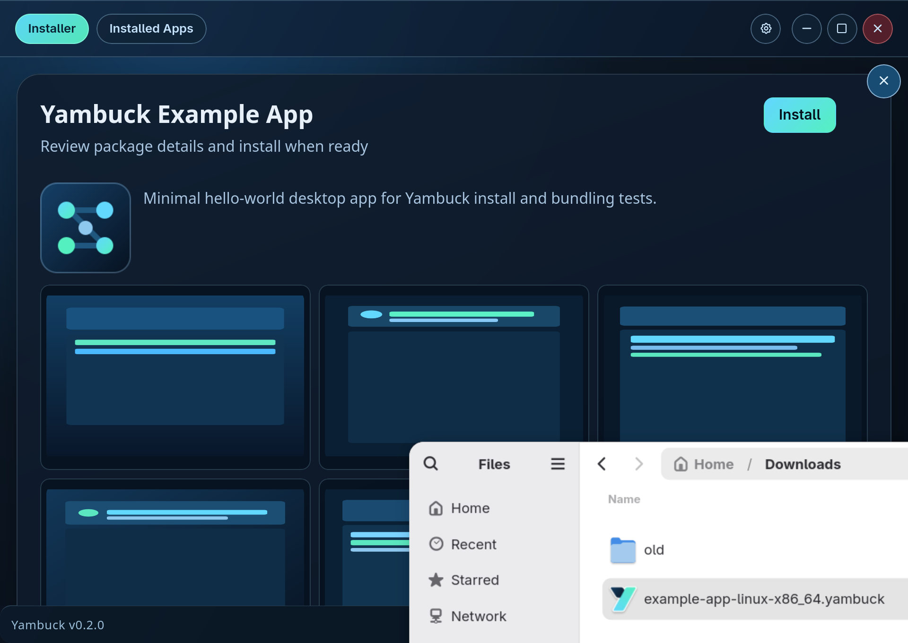
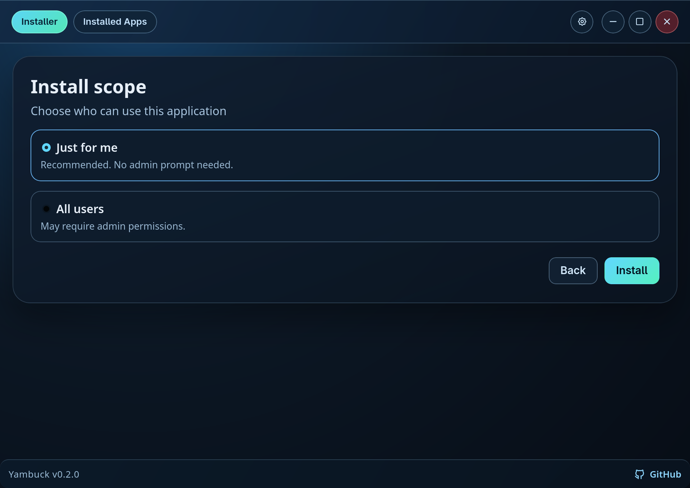
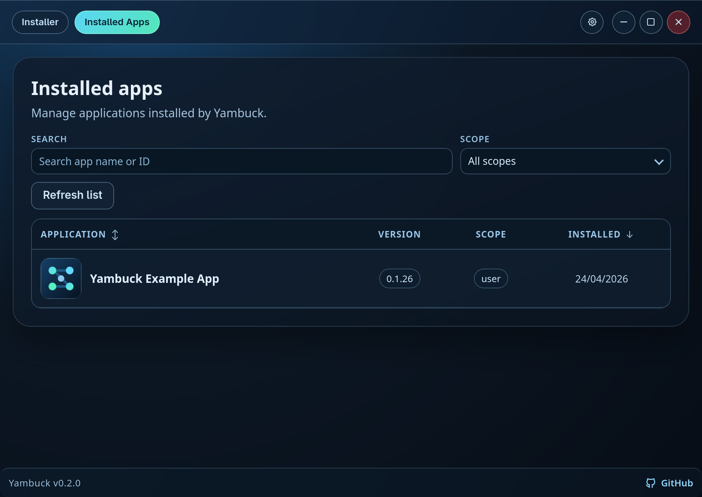
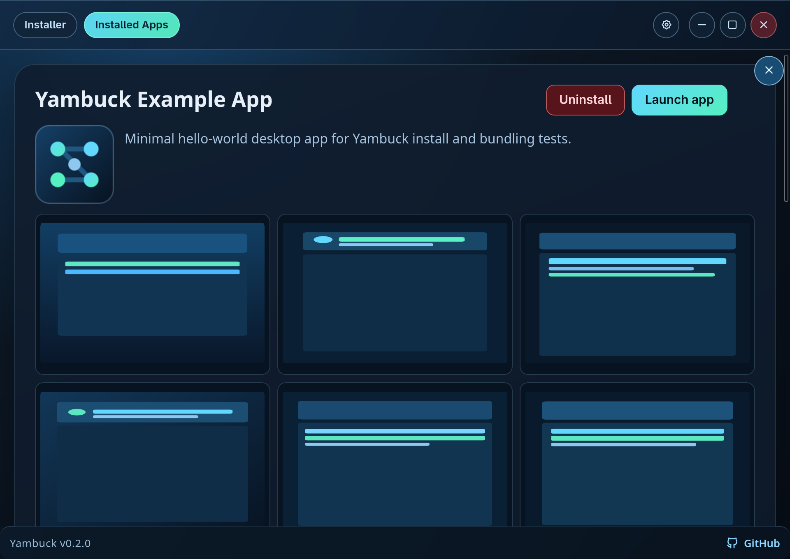

<p align="center">
  
</p>

<h1 align="center">Yambuck</h1>

<p align="center">Simple Linux app installs.<br />One guided installer for Linux software that works the same on every distro, instead of distro-specific app stores and package formats.</p>

<p align="center">
  <a href="https://github.com/yambuck/yambuck/releases/latest"></a>
  
  <a href="LICENSE"></a>
</p>

<p align="center">
  <a href="https://yambuck.com/">Website</a> ·
  <a href="https://github.com/yambuck/yambuck/releases/latest">Downloads</a> ·
  <a href="docs/PACKAGE_SPEC.md">Package format</a> ·
  <a href="https://github.com/yambuck/yambuck/issues">Report an issue</a>
</p>

## Install

**Linux** (just for you, in `~/.local/bin`, no password needed)

```bash
curl --proto '=https' --tlsv1.2 -sSf https://yambuck.com/install.sh | bash
```

**Linux** (all users, in `/usr/local/bin`, asks for your password)

```bash
curl --proto '=https' --tlsv1.2 -sSf https://yambuck.com/install.sh | bash -s -- --system
```

Prefer the files? The [latest release](https://github.com/yambuck/yambuck/releases/latest) has the Linux x64 `.tar.gz` and `example-app.yambuck`, a demo package to try the installer. Yambuck is in alpha preview: core flows work, with ongoing reliability improvements. To remove it, see the [uninstall instructions](https://yambuck.com/uninstall.html).

## What it does

Yambuck is one package format and one install flow for Linux apps. Today an app has to ship separately for every distro and package manager; with Yambuck a developer packages once, and anyone on any distro installs it by opening one file.

- Installs an app from a single `.yambuck` file, with a guided installer that shows its details and screenshots first
- Works the same on every Linux distro, with no app store or package format to learn
- Keeps track of what you've installed and uninstalls it cleanly from one place

## Screenshots

<p align="center">
  
  
</p>
<p align="center">
  
  
</p>

[More screenshots](https://yambuck.com/screenshots/)

## For developers

Package once, distribute directly, and let users install with a familiar GUI flow. A `.yambuck` file holds your app with its metadata, icon and screenshots. The [package spec](docs/PACKAGE_SPEC.md) describes the format, and `apps/example-app` is a working example.

## Build from source

```bash
npm --prefix apps/yambuck-gui install
npm --prefix apps/yambuck-gui run tauri dev   # run in development
./scripts/build-example-app-yambuck.sh        # build example-app.yambuck
npm run release:linux                         # build the release in an Ubuntu 22.04 container (needs podman)
```

The release procedure is in [docs/RELEASE.md](docs/RELEASE.md). Contributor notes are in [AGENTS.md](AGENTS.md).

## License

[GNU AGPLv3](LICENSE).

---

<p align="center">
  Yambuck is one of the free apps by <a href="https://brumley.info">Jack Brumley</a>:<br />
  <a href="https://voquill.org">Voquill</a> · <a href="https://brumley.info/rusty-g6/">Rusty G6</a> · <a href="https://somedrive.org/">SomeDrive</a> · <b>Yambuck</b> · <a href="https://brumley.info/rawtap/">RawTap</a> · <a href="https://bmuster.com/">BMuster</a>
</p>
